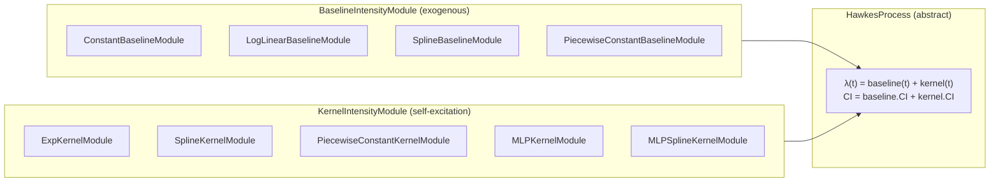
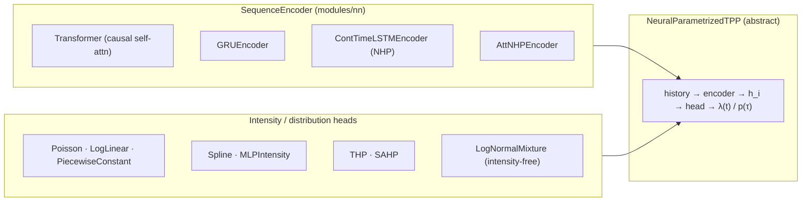
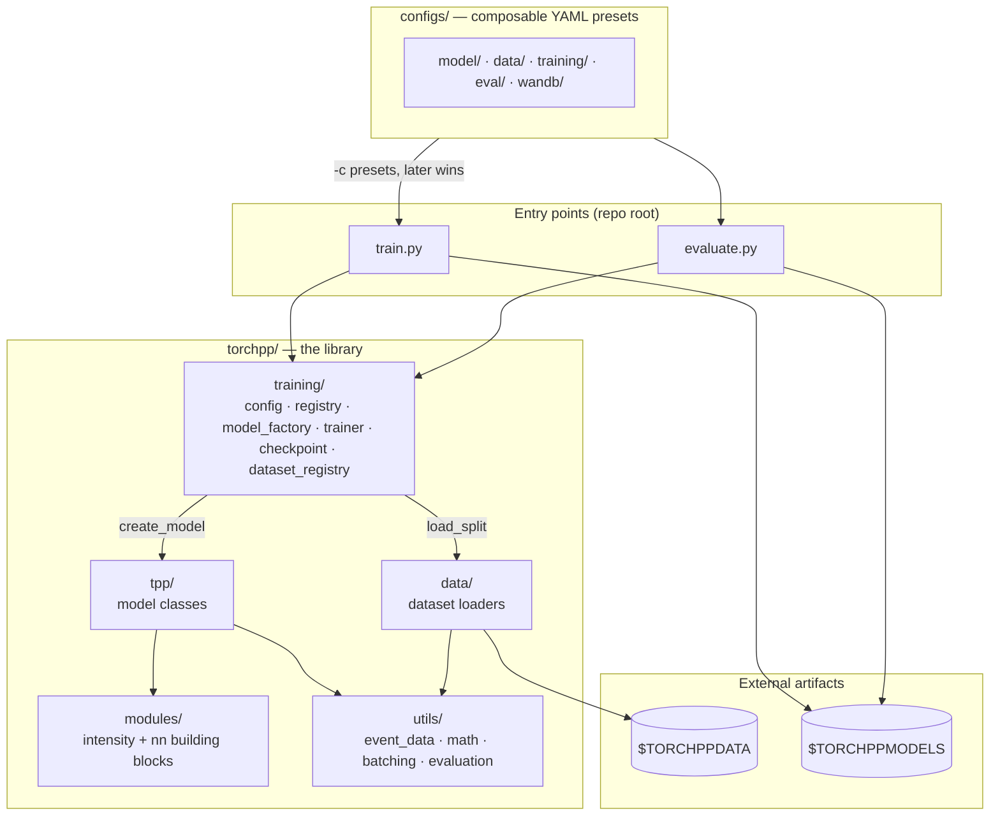
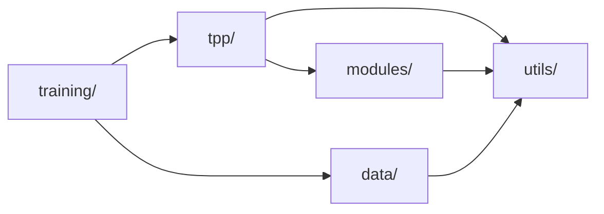

# Architecture

*This page is for contributors. Users should start with the [introduction](./introduction.md)
and the [notation](./notation.md).*

This page explains how `torchpp` represents temporal point processes internally. It covers the
abstract base class, the predictive, likelihood and sampling contract that every model exposes,
the modular composition of Hawkes processes, and the handling of terminating processes.

## Class hierarchy

```
TemporalPointProcess                (torchpp/tpp/base_tpp.py — abstract root: the contract)
└── AutoregressiveTPP               (torchpp/tpp/base_tpp.py — shared next-event likelihood factorization)
    ├── IntensityBasedTPP           (torchpp/tpp/base_tpp.py — the intensity harness)
    │   ├── BaselineTPP             (torchpp/tpp/baseline.py)
    │   │   ├── PoissonProcess
    │   │   ├── LogLinearPoissonProcess
    │   │   ├── SplinePoissonProcess
    │   │   └── PiecewisePoissonProcess
    │   ├── HawkesProcess           (torchpp/tpp/hawkes.py, ABC: baseline + kernel)
    │   │   ├── ConstBaselineExpKernelHawkesProcess
    │   │   ├── LogLinearBaselineExpKernelHawkesProcess
    │   │   ├── SplineBaselineExpKernelHawkesProcess
    │   │   ├── ConstBaselineSplineKernelHawkesProcess
    │   │   ├── SplineBaselineSplineKernelHawkesProcess
    │   │   └── …                   (full list in models.md)
    │   ├── InhibitiveHawkesProcess (sum-then-clamp; numerical CI)
    │   │   ├── InhibitiveConstBaselineExpKernelHawkesProcess
    │   │   ├── InhibitiveSplineBaselineExpKernelHawkesProcess
    │   │   ├── InhibitiveSplineBaselineSplineKernelHawkesProcess
    │   │   ├── InhibitiveSplineBaselineMLPKernelHawkesProcess
    │   │   └── InhibitiveSplineBaselineMLPSplineKernelHawkesProcess
    │   └── NeuralParametrizedTPP   (torchpp/tpp/neural.py)
    │       ├── TransformerParametrizedTPP
    │       │   ├── NeuralPoissonProcess
    │       │   ├── NeuralLogLinearProcess
    │       │   ├── NeuralSplineProcess
    │       │   ├── NeuralPiecewiseConstantProcess
    │       │   ├── NeuralMLPProcess
    │       │   ├── THPProcess
    │       │   └── SAHPProcess
    │       ├── NHPProcess
    │       └── AttNHPProcess
    └── DensityBasedTPP             (torchpp/tpp/base_tpp.py — inter-event-density family)
        └── IntensityFreeProcess    (torchpp/tpp/neural.py — log-normal mixture)
```

The diagram below shows the same tree as a [Mermaid](https://mermaid.js.org/) class diagram,
which renders in the GitHub and VS Code previews.

```mermaid
classDiagram
    class TemporalPointProcess {
        <<abstract nn.Module>>
        +D, seed, terminating, has_origin
        +time_scale (buffer)
        +predictable_mask (buffer)
        +likelihood(ts, log)*
        +sample(ts, ...)*
        +density_joint() / density_time()
        +cdf_time() / survival_time()
        +prob_mark() / prob_mark_given_time()
        +time_mean() / time_quantile()
    }
    class AutoregressiveTPP {
        <<abstract>>
        next-event factorization
        +likelihood() +loss()
    }
    class IntensityBasedTPP {
        <<abstract>>
        +intensity(t, ts)
        +cumulative_intensity(T, ts)
        +ci_config / use_ci
        +sampling_config / use_sampling
    }
    class DensityBasedTPP {
        <<abstract>>
        f(tau) + mark head
    }
    class HawkesProcess {
        <<abstract>> baseline + kernel
    }
    class InhibitiveHawkesProcess {
        <<abstract>> sum-then-clamp
    }
    class NeuralParametrizedTPP {
        <<abstract>> encoder + head
    }

    TemporalPointProcess <|-- AutoregressiveTPP
    AutoregressiveTPP <|-- IntensityBasedTPP
    AutoregressiveTPP <|-- DensityBasedTPP
    IntensityBasedTPP <|-- BaselineTPP
    IntensityBasedTPP <|-- HawkesProcess
    IntensityBasedTPP <|-- InhibitiveHawkesProcess
    IntensityBasedTPP <|-- NeuralParametrizedTPP
    DensityBasedTPP <|-- IntensityFreeProcess

    BaselineTPP <|-- PoissonProcess
    BaselineTPP <|-- LogLinearPoissonProcess
    BaselineTPP <|-- SplinePoissonProcess
    BaselineTPP <|-- PiecewisePoissonProcess

    HawkesProcess <|-- ConstBaselineExpKernelHawkesProcess
    HawkesProcess <|-- SplineBaselineExpKernelHawkesProcess
    HawkesProcess <|-- SplineBaselineSplineKernelHawkesProcess
    HawkesProcess <|-- ConstBaselineSplineKernelHawkesProcess

    InhibitiveHawkesProcess <|-- InhibitiveConstBaselineExpKernelHawkesProcess
    InhibitiveHawkesProcess <|-- InhibitiveSplineBaselineExpKernelHawkesProcess
    InhibitiveHawkesProcess <|-- InhibitiveSplineBaselineSplineKernelHawkesProcess
    InhibitiveHawkesProcess <|-- InhibitiveSplineBaselineMLPKernelHawkesProcess
    InhibitiveHawkesProcess <|-- InhibitiveSplineBaselineMLPSplineKernelHawkesProcess

    NeuralParametrizedTPP <|-- TransformerParametrizedTPP
    NeuralParametrizedTPP <|-- NHPProcess
    NeuralParametrizedTPP <|-- AttNHPProcess
    TransformerParametrizedTPP <|-- NeuralPoissonProcess
    TransformerParametrizedTPP <|-- NeuralLogLinearProcess
    TransformerParametrizedTPP <|-- NeuralSplineProcess
    TransformerParametrizedTPP <|-- NeuralPiecewiseConstantProcess
    TransformerParametrizedTPP <|-- NeuralMLPProcess
    TransformerParametrizedTPP <|-- THPProcess
    TransformerParametrizedTPP <|-- SAHPProcess
```



`TemporalPointProcess` is the abstract `nn.Module` root. It holds only the part of the contract
that does not depend on the model family, namely the likelihood, sampling and the next-event
predictive distributions. `IntensityBasedTPP` realizes this contract through an intensity λ and a
cumulative intensity Λ. `DensityBasedTPP` realizes it directly from an inter-event-time density.
Every concrete model is a `torch.nn.Module` and can be trained with the standard PyTorch
optimization loop.

## What every model exposes

The uniform API is the **predictive, likelihood and sampling contract**, not the intensity. Every
model, whether intensity-based or density-based, implements the same methods. Their signatures
are listed in the [API reference](./api_reference.md#base-classes) and their definitions in
[Notation](./notation.md). Only `likelihood` and `sample` are abstract. The other methods have
generic fallbacks that follow from the decomposition identities, and each family base class
overrides the parts it can compute directly. The intensity family realizes them from
$\lambda_d(t \mid \mathcal{H}_t)$ as follows:

| Method | Intensity-family realization |
|---|---|
| `likelihood` | $\sum_{i \in \mathcal{I}} \log \lambda_{m_i}(t_i) - \sum_d \Lambda_d(t_s, T)$ |
| `density_joint` | $\lambda_d(t)\,S(t)$ |
| `density_time` | $\sum_d \lambda_d(t)\,S(t)$ |
| `cdf_time` / `survival_time` | $1 - S(t)$ / $S(t)$ |
| `prob_mark` | $\int_{t_0}^{\infty} \lambda_d(s)\,S(s)\,ds$ on a grid, normalized |
| `prob_mark_given_time` | $\lambda_d(t) / \sum_{d'} \lambda_{d'}(t)$ |
| `time_mean` | $t_0 + \int_{t_0}^{\infty} S(s)\,ds$ on a grid |
| `time_quantile` | grid- or Newton-based inverse of `cdf_time` |
| `sample` | inversion or thinning (`SamplingConfig`) |

All of these methods forecast from $t_0$ (see
[Notation → Forecasting](./notation.md#forecasting-from-t_obs)). Integrals that start at an event
use the post-jump intensity $\lambda(t^+)$.

## Time units

Every model **owns its time normalization**. The public methods (`likelihood`, `density_*`,
`intensity`, `cumulative_intensity`, `time_mean`, `time_quantile`, `sample`) accept and return
times in the **native units** of the dataset, for example days. The entire computational core,
however, runs in **scaled units** `t / s`, where `s = model.time_scale`.

- `time_scale` is a scalar float **buffer** on `TemporalPointProcess`. It is therefore saved in
  the `state_dict` and moves with `.to(device)`. It defaults to `1.0`, which leaves all times
  unchanged.
- After construction, `create_model(...)` sets `s` to the **mean inter-event time of the training
  set**. It also rescales every data-driven initialization statistic into scaled units, so that
  spline knots and baselines are placed where the scaled core evaluates them. A checkpoint that
  carries its own `time_scale` overrides this value on load. A checkpoint without the buffer
  keeps the value set by `create_model`.
- The public shell normalizes the inputs on entry (`t / s`) and converts back on exit. Densities
  per unit time pick up a `− log s` Jacobian per scored event, while dimensionless quantities
  (survival, CDF, mark probabilities) are unchanged. `time_mean` and `time_quantile` return
  times in native units.

Because the model reports its quantities in native units directly, the evaluation metrics read
`model.time_scale` and not a dataset-level factor. Datasets emit **raw native-unit** times and
apply no scaling of their own (see [Data → Time units](./data.md#time-units)).

## Token roles and origin

`create_model` sets two dataset properties on every model. The first is `predictable_mask`, a
`(D,)` bool buffer that is `False` for context types. The second is `has_origin`. Both are
defined in [Notation → Token roles](./notation.md#token-roles) and
[Notation → Origin](./notation.md#origin-first-event-conditioning). Neural heads have no learned
prior parameter. Without an origin, the empty-history state is a column of zeros at index 0,
which is never scored.

## Subclass contract

An intensity model subclasses `IntensityBasedTPP` and overrides one required hook.

- `_intensities_at_queries(query_times, ts) -> (B, Q, D)` computes the raw intensity at
  arbitrary query times, before termination masking. The base class wraps it in
  [`intensity()`](../torchpp/tpp/base_tpp.py) and applies the termination mask there. A
  single-query evaluation is computed as `_intensities_at_queries(t.unsqueeze(1), ts).squeeze(1)`.
  The hook is enforced at subclass creation.

The classical models (Hawkes and Baseline) additionally follow a
`transform_params() -> Tuple[Tensor, ...]` convention. This *optional* helper returns the
constrained form of the parameters. The raw parameters are stored unconstrained and mapped
through `softplus`/`exp` to enforce positivity. You can use
[`torchpp.utils.math.inverse_softplus`](../torchpp/utils/math.py) to set their initial values.
The helper is not part of the base contract, and the neural models do not define it.

Concrete models *should* override the following hooks when this is tractable:

- `_closed_form_ci(ts, T_low, T) -> (B, D)`, or the per-interval
  `_interval_ci(ts, t_lo, t_hi)`, computes the closed-form cumulative intensity over
  `[T_low or 0, T]`. It is selected when the `CIConfig` of the model is `closed_form`, which is
  the default. The base class folds termination into the per-type upper limit
  `min(T, t_term_d)`, so these hooks never need to inspect termination times. A model without a
  closed form declares numerical integration through `_default_ci_config()` instead (see below).
- `_event_intensities(ts) -> (B, L)` computes the intensity of the observed type at every
  position directly, when this is possible without materializing the full `(B, L, D)` tensor.
  The neural models override it for efficiency. The base class handles padding, log-clamping and
  the terminating-repeat penalty inside `likelihood`.

A density model subclasses `DensityBasedTPP` instead. It roots the family by implementing the
density hooks (`_log_density_time_given_mark`, `_log_survival_time_given_mark`,
`_log_prob_mark`, `_event_log_density_sum`, `_draw_next`, `time_mean`), and no intensity is
involved.

## Numerical vs closed-form cumulative intensity

The scheme for the cumulative intensity is a value object, `CIConfig`. A call argument takes
precedence over an active `use_ci(cfg)` context, which in turn takes precedence over the model's
`_default_ci_config()`. `cumulative_intensity` dispatches on the resolved config.

- The closed-form mode (`CIConfig(mode="closed_form")`) dispatches to the analytic per-interval
  hook of the model (`_interval_ci` / `_closed_form_ci`). All Hawkes and Baseline composites and
  the closed-form neural heads use it.
- The numerical mode (`CIConfig(mode="numerical", ...)`) uses quadrature via
  [`numerical_integration`](../torchpp/utils/math.py). `placement` selects either per-interval
  integration with knots at the events (`interval`) or a fixed budget of points over the whole
  window (`global`). `rule` ∈ `{"trapezoidal", "mc", "mc_trapezoidal"}` and `n_points` (default
  `100`) set the quadrature. We use it when the intensity has no closed-form integral, for
  example for `InhibitiveHawkesProcess`, the MLP-kernel composites and the numerical neural heads
  (NHP, AttNHP, MLP, THP/SAHP).

Each family sets its default through `_default_ci_config()`. Most families use the closed form,
and the numerical families declare their scheme explicitly. Wrapping a block in
`with model.use_ci(cfg):` redirects every CI call inside the block without modifying the model.
The evaluation harness uses this to force a high-precision scheme.

To invert a numerical CI (for sampling and quantile prediction), the base class builds an
[`IntensityGrid`](../torchpp/utils/math.py) once and inverts it by linear interpolation in O(1)
per query. This avoids repeating the numerical integration inside a Newton loop.

## Hawkes composition

The Hawkes models in `torchpp/tpp/hawkes.py` are assembled from two reusable building blocks,
which are defined in [`torchpp/modules/intensity.py`](../torchpp/modules/intensity.py).

- `BaselineIntensityModule` is the exogenous component $\mu_d(t)$. Its concrete subclasses are
  `ConstantBaselineModule`, `LogLinearBaselineModule`, `SplineBaselineModule` and
  `PiecewiseConstantBaselineModule`.
- `KernelIntensityModule` is the endogenous, self-exciting component
  $\sum_{i: t_i < t} \phi_{m_i, d}(t - t_i)$. Its concrete subclasses are `ExpKernelModule`,
  `SplineKernelModule`, `PiecewiseConstantKernelModule`, `MLPSplineKernelModule` and
  `MLPKernelModule`.

```
HawkesProcess(D, baseline=Baseline(...), kernel=Kernel(...))
  intensity(t)   = baseline(t) + kernel(t)
  CI([0, T])     = baseline.CI(0, T) + kernel.CI(0, T)   (analytical when both modules support it)
```



A concrete Hawkes class is essentially a declaration of which baseline and which kernel to
instantiate. The combinatorial model zoo (`spline_exp_hawkes`, `const_spline_hawkes`,
`spline_spline_hawkes`, …) is generated from this small set of orthogonal modules, and the
models are not written by hand one by one.

`InhibitiveHawkesProcess` wraps the *sum* in a function that enforces positivity,
$\mathrm{clamp}(\mu(t) + \kappa(t))$. This function is `softplus`, `relu` or `exp`, and the full
list is in [`hawkes.py::VALID_CLAMPING_FNS`](../torchpp/tpp/hawkes.py). Because the clamp is
non-linear, the CI no longer decomposes into the two modules and is computed numerically. This
allows "inhibitive" behavior, where some kernel weights are negative.

The bottom of `hawkes.py` contains a list of thin compositions that select specific
baseline/kernel pairs. You add a new composition by writing one such class and registering it
(see [Extending](./extending.md)).

## Neural TPPs

`NeuralParametrizedTPP` (in [`torchpp/tpp/neural.py`](../torchpp/tpp/neural.py)) couples a
sequence encoder with a parametric inter-event intensity head. The encoder is the causal
transformer in [`torchpp/modules/nn/`](../torchpp/modules/nn/). For each event position, the
encoder produces a vector of head parameters, and the head defines $\lambda_d(t)$ for $t$ between
that event and the next.

`TransformerParametrizedTPP` adds caching of these parameters per batch. The transformer runs
once per batch, and intensity and CI queries at arbitrary times look up the parameters of the
current inter-event interval. **Any change to the caching or lookup logic must preserve causal
semantics for simultaneous events and for time queries between observed events.** Validate such
changes with the targeted neural-model tests, and not only with the generic matrix. The cache is
keyed on the scaled *content* of the batch, so the batches that the time-unit shell rescales on
every call still hit the cache (see [Time units](#time-units)).



The `thp`, `sahp`, `nhp` and `attnhp` types keep their original intensity heads with a numerical
CI. `intensity_free` is ported as a `DensityBasedTPP`. All of them still subclass
`TemporalPointProcess`, so the evaluation treats them identically through the contract.

We implement the following concrete heads:

- `NeuralPoissonProcess` has a constant intensity per interval.
- `NeuralLogLinearProcess` has a log-linear intensity with an analytical CI.
- `NeuralSplineProcess` has a linear-spline intensity with an analytical CI.
- `NeuralPiecewiseConstantProcess` has a piecewise-constant intensity.
- `NeuralMLPProcess` has an MLP-parametrized intensity with a numerical CI.
- `THPProcess` and `SAHPProcess` implement the THP and SAHP intensity heads, which use a
  scaled-softplus intensity with a numerical CI.

## Terminating mode

Setting `terminating=True` restricts each event type to occur at most once per sequence, as in
first-occurrence disease data. The computation is implemented as pure functions of the event data
in [`torchpp/utils/event_data.py`](../torchpp/utils/event_data.py). The model carries the
`terminating`/`D` configuration and calls these functions through thin method wrappers
(`_get_termination_mask`, `_get_termination_times`, …). Termination enters the math in three
places.

- `_get_termination_mask(ts, t)` returns a `(B, D)` tensor that is `True` where the type has
  *not* yet occurred strictly before $t$. `intensity()` multiplies by this mask, so
  $\lambda_d(t) = 0$ once type $d$ has occurred.
- `_get_termination_times(ts)` returns a `(B, D)` tensor with the first-occurrence time of each
  type, or `inf` for types that have not occurred. The closed-form CI path clamps the per-type
  upper integration bound to $\min(T, t_{\text{term},d})$. The numerical CI path inserts these
  termination times as exact grid knots.
- `likelihood` detects sequences with a repeated type and sets their log-likelihood to $-\infty$
  (via the positive term), since such sequences have probability zero under a terminating model.

Subclasses do **not** need to handle termination themselves. They implement the intensity and CI
hooks as if the process were non-terminating, and the base class adds the masking and the
effective upper limits.

## Tensor shape conventions

| Quantity | Shape |
|---|---|
| Time inputs (`t`, `T`) | `(B,)` |
| Per-batch, per-type | `(B, D)` |
| Per-event | `(B, L)` — padding marked by `event_types == -1` |
| Per-event, per-type | `(B, L, D)` |
| Per-sequence likelihood | `(B,)` |

Event types are padded with `-1`. Padded times are set to the largest time in the batch plus
`1.0`, which is a single value for the whole batch. Always derive masks from
[`BatchedMVEventData.event_mask`](../torchpp/utils/event_data.py) or `time_points_before(t)`
instead of relying on the raw padded values. `event_types_idx_safe` exists to avoid invalid
indexing on padded entries. It replaces `-1` with `0`, and the result is then masked out by
`event_mask`.

## Numerical-stability notes

- The argument to `log` in the positive likelihood term is floored at `finfo.tiny`. The raw
  intensity that enters the survival integral stays unclamped, so a rate that is structurally
  zero cannot add spurious mass to Λ.
- `LinearSpline` ([`torchpp/utils/math.py`](../torchpp/utils/math.py)) guards against `inf * 0`
  with a conditional `torch.where`.
- CI inversion uses a bracketed Newton method (`invert_CI`) for models with an analytical CI and
  grid-based linear interpolation for models with a numerical CI.
- For repeated CI queries during marginal computations, `IntensityGrid` caches a single pass of
  intensity evaluations and provides O(1) lookup.

## Repository layout and pipeline

The `torchpp/` library is the core of the repository. Everything else (`configs/`, `scripts/`,
`train.py`, `evaluate.py`, `tests/`) is tooling around it. The entry points stay thin. They parse
the config, build the model, load the data, run the training loop and log the results. All
modeling logic lives in the library, where it can be imported and tested.



Within the library, `utils/` is the foundation and has no dependencies on the other subpackages.
`tpp/` and `modules/` build on it, and `training/` sits on top and connects everything to the
config.



The following diagram shows the end-to-end training and evaluation flow.

```mermaid
sequenceDiagram
    participant CLI as train.py
    participant Cfg as FitConfig
    participant Reg as dataset_registry
    participant Fac as model_factory
    participant Fit as trainer.fit
    participant Model as TemporalPointProcess
    participant Eval as utils.evaluation
    CLI->>Cfg: merge defaults ← YAML -c presets ← key=value
    CLI->>Reg: load_split(dataset_type, cfg, root, split)
    Reg-->>CLI: TPPDataset (+ DatasetStats)
    CLI->>Fac: create_model(model_type, arch, D, dataset_stats, seed)
    Fac-->>CLI: model (knots placed from stats; time_scale + roles stamped)
    CLI->>Fit: fit(model, train, val, config)
    loop num_steps
        Fit->>Model: −likelihood (NLL) → backprop
        Fit->>Model: periodic val likelihood (early-stop best)
    end
    Fit-->>CLI: FitResult (best weights restored)
    CLI->>CLI: save_model(path, model, model_type, arch, …)
    CLI->>Eval: evaluate_tpp(model, test_sequences)
    Eval-->>CLI: LL + next-event-type / next-time metrics
```

### API design principles (summary)

| Principle | Where it shows up | Why |
|---|---|---|
| Contract root + family realizations | `TemporalPointProcess` → `IntensityBasedTPP` / `DensityBasedTPP` | New models implement only their parametrization and roots. Likelihood, sampling and evaluation are inherited. |
| Analytical *or* numerical CI behind one call | `cumulative_intensity` + `CIConfig` | Closed-form and integration models share one likelihood path. |
| Composition over inheritance | baseline ⊕ kernel; encoder ⊕ head | The model zoo is built combinatorially from a few orthogonal modules. |
| Model-owned time normalization | `time_scale` buffer | Data stays in raw native units, and the same config generalizes across time scales. |
| Causality-aware tensor container | `BatchedMVEventData` (`EventSequence`/TensorDict) | The masking and padding contract is defined in one place and not re-derived in each model. |
| String → class registries | `create_model`, `DATASET_REGISTRY` | The CLI and configs stay declarative, and extending the library means registering a class. |
| Typed, composable, fail-loud config | `FitConfig` + OmegaConf presets | Runs are reproducible, presets can be stacked, and typos are rejected up front. |

## File map (where things live)

| Concern | Location |
|---|---|
| Abstract base, likelihood, sampling | [`torchpp/tpp/base_tpp.py`](../torchpp/tpp/base_tpp.py) |
| Poisson family | [`torchpp/tpp/baseline.py`](../torchpp/tpp/baseline.py) |
| Hawkes composites | [`torchpp/tpp/hawkes.py`](../torchpp/tpp/hawkes.py) |
| Neural TPPs | [`torchpp/tpp/neural.py`](../torchpp/tpp/neural.py) |
| Baseline/kernel modules | [`torchpp/modules/intensity.py`](../torchpp/modules/intensity.py) |
| Causal transformer | [`torchpp/modules/nn/`](../torchpp/modules/nn/) |
| Event containers, padding/masks | [`torchpp/utils/event_data.py`](../torchpp/utils/event_data.py) |
| Bucket/dynamic batching | [`torchpp/utils/batching.py`](../torchpp/utils/batching.py) |
| Math utilities | [`torchpp/utils/math.py`](../torchpp/utils/math.py) |
| Evaluation metrics | [`torchpp/utils/evaluation.py`](../torchpp/utils/evaluation.py) |
| Datasets | [`torchpp/data/`](../torchpp/data/) |
| Config schema, factory | [`torchpp/training/`](../torchpp/training/) |
