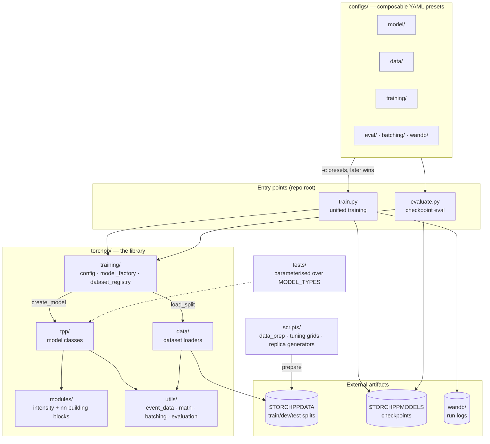
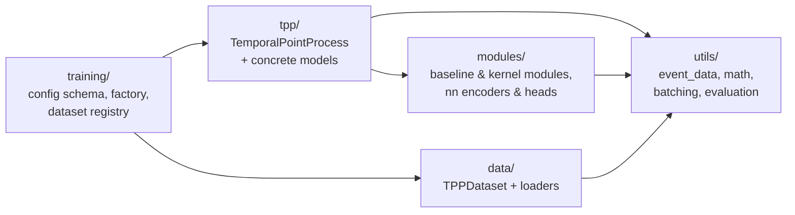
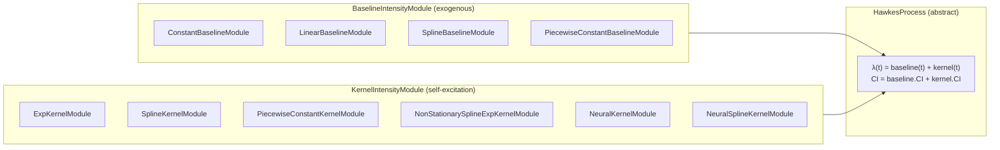
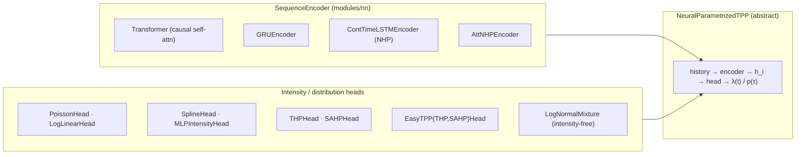
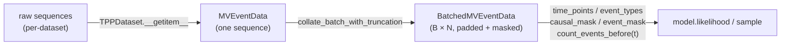
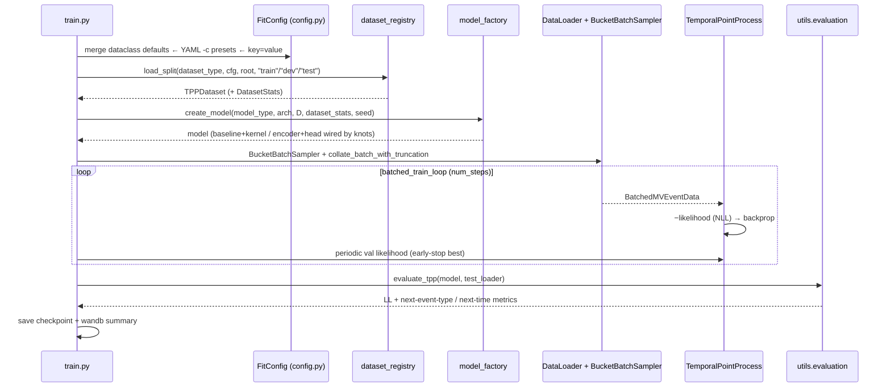

# torchpp — Architecture & Design Overview

A visual map of how the pieces of this repository relate, and the design / API
choices behind them. Diagrams are [Mermaid](https://mermaid.js.org/) (rendered
inline on GitHub / VS Code preview).

`torchpp/` is a PyTorch library for **multivariate temporal point processes
(TPPs)**. Its central bet is a *single uniform API* — likelihood, cumulative
intensity, sampling, evaluation — shared across classical Hawkes, neural, and
hybrid models, so they can be benchmarked head-to-head for the NeurIPS paper.

---

## 1. Repository layout & data flow

How the directories relate: the `torchpp/` library is the core; everything else
(`configs/`, `scripts/`, `train.py`, `evaluate.py`, `tests/`) is reproduction
machinery wrapped around it.

**Design choice — thin entry points, fat library.** `train.py` / `evaluate.py`
only orchestrate (parse config → build model → load data → loop → log). All
modeling logic lives in `torchpp/` so it is importable and testable
independently of the CLI.

---

## 2. The five subpackages and their dependencies

`utils/` is the foundation (no internal deps); `tpp/` and `modules/` build on
it; `training/` sits on top and wires everything to config.

---

## 3. Model class hierarchy

Every model is a subclass of the single abstract base `TemporalPointProcess`.
Three families descend from it, plus the modular Hawkes split.

```mermaid
classDiagram
    class TemporalPointProcess {
        <<abstract nn.Module>>
        +D, seed, terminating
        +likelihood(ts, log)*
        +sample(ts, ...)*
        +transform_params()*
        +density_joint() / density_time()
        +cdf_time() / survival_time()
        +prob_mark() / prob_mark_given_time()
        +time_mean() / time_quantile()
    }

    class IntensityBasedTPP {
        <<abstract>>
        +intensity(t, ts)
        +cumulative_intensity(T, ts)
        +ci_config / use_ci
        +sampling_config / use_sampling
    }
    class DensityBasedTPP {
        <<abstract>>
        f(tau) + mark head
    }
    class BaselineTPP {
        <<abstract>>
    }
    class HawkesProcess {
        <<abstract>>
        baseline + kernel
    }
    class InhibitiveHawkesProcess {
        <<abstract>>
    }
    class NeuralParametrizedTPP {
        <<abstract>>
        encoder + head
    }
    class TransformerParametrizedTPP

    TemporalPointProcess <|-- IntensityBasedTPP
    TemporalPointProcess <|-- DensityBasedTPP

    IntensityBasedTPP <|-- BaselineTPP
    IntensityBasedTPP <|-- HawkesProcess
    IntensityBasedTPP <|-- InhibitiveHawkesProcess
    IntensityBasedTPP <|-- NeuralParametrizedTPP
    DensityBasedTPP <|-- IntensityFreeProcess

    BaselineTPP <|-- PoissonProcess
    BaselineTPP <|-- ConditionalInhomogeniousPoissonProcess
    BaselineTPP <|-- SplinePoissonProcess
    BaselineTPP <|-- PiecewiseConstantPoissonProcess

    HawkesProcess <|-- ConstBaselineExpKernelHawkesProcess
    HawkesProcess <|-- SplineBaselineExpKernelHawkesProcess
    HawkesProcess <|-- SplineBaselineSplineKernelHawkesProcess
    HawkesProcess <|-- ConstBaselineSplineKernelHawkesProcess

    InhibitiveHawkesProcess <|-- InhibitiveConstExpHawkesProcess
    InhibitiveHawkesProcess <|-- InhibitiveSplineExpHawkesProcess
    InhibitiveHawkesProcess <|-- SplineBaselineNeuralKernelHawkesProcess
    InhibitiveHawkesProcess <|-- SplineBaselineNeuralSplineKernelHawkesProcess

    NeuralParametrizedTPP <|-- TransformerParametrizedTPP
    NeuralParametrizedTPP <|-- NHPProcess
    NeuralParametrizedTPP <|-- AttNHPProcess

    TransformerParametrizedTPP <|-- NeuralPoissonProcess
    TransformerParametrizedTPP <|-- NeuralLogLinearProcess
    TransformerParametrizedTPP <|-- NeuralSplineProcess
    TransformerParametrizedTPP <|-- NeuralMLPProcess
    TransformerParametrizedTPP <|-- NeuralTHPProcess
    TransformerParametrizedTPP <|-- NeuralSAHPProcess
    TransformerParametrizedTPP <|-- EasyTPPTHPProcess
    TransformerParametrizedTPP <|-- EasyTPPSAHPProcess
```

**Design choice — the contract is the uniform API; the intensity is one
realization of it.** The abstract root `TemporalPointProcess` declares the
family-agnostic contract — `likelihood`, `sample`, and the next-event
predictive distributions (`density_*` / `prob_*` / `time_*`) — with generic
fallbacks from the decomposition identities. Two family bases realize it:

- `IntensityBasedTPP` realizes the contract through the conditional intensity
  λ(t | history) and cumulative intensity ∫λ; a concrete intensity model
  provides only `transform_params()` and one intensity hook (`_intensity_at_t`
  or `_intensities_at_queries`).
- `DensityBasedTPP` realizes it directly from an inter-event-time density
  f(τ) and a mark head (e.g. `IntensityFreeProcess`), with no intensity.

Everything else — NLL, the predictive distributions, `sample`, the point
predictors — is derived generically. For the intensity family, a `CIConfig`
value object (resolved call-arg > `use_ci` context > per-family default)
decides whether ∫λ comes from a closed form or numerical integration, which is
what lets Hawkes and neural models share the same likelihood path.

---

## 4. Hawkes models = baseline ⊕ kernel composition

Hawkes models are *not* monolithic. `λ(t) = baseline(t) + kernel(t)`, and each
side is an interchangeable `nn.Module`. The model class just picks a (baseline,
kernel) pair; intensity and cumulative-intensity are computed by summing the two
modules' contributions.

Both module interfaces expose the same trio: `intensity(t, ts)`,
`cumulative_intensity(T, ts)`, and `event_intensities(ts)` (a fast pass over all
observed events at once). Concrete Hawkes classes like
`SplineBaselineExpKernelHawkesProcess` are essentially declarations of which
baseline + kernel to instantiate.

**Design choice — mix-and-match modularity.** The combinatorial set of named
model types (`spline_exp_hawkes`, `const_spline_kernel`,
`spline_spline_kernel`, …) is generated from a small set of orthogonal baseline
and kernel modules rather than hand-written per-model intensity code. "Hybrid"
models (`neural_hawkes`, `neural_spline_hawkes`) just drop a neural kernel into
the same slot — they're still Hawkes processes structurally.

---

## 5. Neural models = encoder ⊕ intensity head

Neural TPPs follow a parallel composition: a sequence **encoder** turns history
into per-position hidden states, and an intensity/distribution **head** maps
those states to λ(t) (or directly to a next-time distribution).

**Design choice — faithful baselines vs. unified-API variants.** The
`easytpp_*`, `nhp`, and `attnhp` types are intensity ports kept deliberately
close to the original EasyTPP implementations (numerical CI, original heads);
`intensity_free` is ported as a `DensityBasedTPP` (a log-normal mixture over the
inter-event time, no intensity). These faithful ports keep the paper's
comparisons fair, while the `neural_*` family reuses torchpp's own
spline/loglinear/MLP intensity heads. Every kind still subclasses
`TemporalPointProcess`, so evaluation treats them identically through the
contract.

---

## 6. Data representation: `MVEventData` / `BatchedMVEventData`

All sequences flow through TensorDict-backed containers. This is the lingua
franca between datasets, models, and evaluation.

**Design choice — a tensor container that knows about causality.**
`BatchedMVEventData` subclasses `TensorDict` and carries query helpers the
intensity math needs — padding masks, causal/attention masks,
`count_events_before(t)`, `event_time_before(t)`, per-type `real_counts()`. This
keeps masking logic out of every model and centralizes the padding/causality
contract in one place. `DatasetStats.from_sequences` precomputes summary
statistics (p95 sequence time, p95 inter-event time) that the model factory uses
to place spline knots automatically.

---

## 7. Training & evaluation pipeline

**Design choices in the pipeline:**

- **Config = typed dataclass tree, 3 merge layers.** `FitConfig` (defaults) ◁
  `-c` YAML presets (composable via `defaults:`, later wins) ◁ dotted
  `key=value` CLI overrides. OmegaConf struct mode rejects unknown keys, so
  typos fail loudly. `MISSING` fields force a value from some layer.
- **Two registries decouple strings from classes.** `VALID_MODEL_TYPES` +
  `create_model` map a model-type string to a constructed model;
  `DATASET_REGISTRY` + `register_dataset` / `load_split` map a dataset string to
  a `TPPDataset` subclass. Adding a model or dataset is a registration, not an
  edit to the training loop.
- **Knot placement is data-driven.** The factory positions spline/piecewise
  knots from `DatasetStats` (e.g. `spline_T_factor * sequence_time_p95` for
  baselines, inter-event p95 for kernels) so the same config generalizes across
  datasets of different time scales.
- **Bucket batching + truncation** (`BucketBatchSampler`,
  `TruncationStrategy`) groups similar-length sequences to limit padding waste
  on the highly variable-length medical datasets.

---

## 8. API design principles (summary)

| Principle | Where it shows up | Why |
|---|---|---|
| **Contract root + family realizations** | `TemporalPointProcess` (contract) → `IntensityBasedTPP` / `DensityBasedTPP` | New models implement only their parametrization + roots; likelihood/sampling/eval are inherited. |
| **Analytical *or* numerical CI behind one call** | `cumulative_intensity` + `CIConfig` | Hawkes (closed form) and neural (integration) share the same likelihood code path. |
| **Composition over inheritance for intensities** | baseline ⊕ kernel; encoder ⊕ head | Combinatorial model zoo from a few orthogonal modules. |
| **Causality-aware tensor container** | `BatchedMVEventData` (TensorDict) | Masking/padding contract centralized, not re-derived per model. |
| **String → class registries** | `create_model`, `DATASET_REGISTRY` | CLI/config stay declarative; extension = registration. |
| **Typed, composable, fail-loud config** | `FitConfig` + OmegaConf presets | Reproducible runs; stacked presets; typos rejected up front. |
| **Faithful ports kept separate** | `easytpp_*`, `nhp`, `attnhp`, `intensity_free` | Fair benchmark comparisons against original implementations. |
| **`$TORCHPPDATA` / `$TORCHPPMODELS` indirection** | dataset_registry, save | Same configs run on laptop / workstation / cluster unchanged. |

---

*Generated as a navigational overview. Source of truth is the code:
`torchpp/tpp/base_tpp.py` (the API), `torchpp/modules/intensity.py` (the
building blocks), and `torchpp/training/{config,model_factory,dataset_registry}.py`
(the wiring).*
