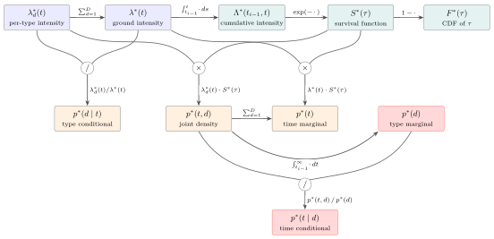
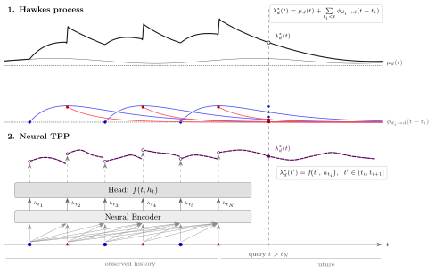

# An introduction to temporal point processes

This page explains what a temporal point process (TPP) is and how every quantity TorchPP
computes follows from one function, the conditional intensity. [Notation](./notation.md) is
the compact reference for the same symbols. The notebook
[`examples/00_tpp_introduction.ipynb`](../examples/00_tpp_introduction.ipynb) computes and plots
every quantity on a small model.

## Events in continuous time

A TPP models **sequences of events in continuous time**. Each event has a time $t_i$ and an
**event type** $m_i$, one of $D$ types $\{0, \dots, D-1\}$. Examples are diagnoses in a
patient record, posts on a forum, trades on an exchange, or earthquakes.

$$
(t_1, m_1),\ (t_2, m_2),\ \dots,\ (t_N, m_N), \qquad 0 \le t_1 \le \dots \le t_N \le T_\mathrm{obs}.
$$

The sequence is observed on the window $[0, T_\mathrm{obs}]$. If $T_\mathrm{obs} > t_N$,
we also know that nothing happened between the last event and $T_\mathrm{obs}$. That
knowledge matters for the likelihood and for forecasts.

The **history** $\mathcal{H}_t$ is the set of events strictly before $t$. A TPP answers
one question: given the history, when does the next event happen, and of which type?

In TorchPP a sequence is an `MVEventData`, and several sequences of different lengths form a
padded `BatchedMVEventData`.

```python
seq = MVEventData(torch.tensor([0.4, 1.1, 1.3, 2.7]), torch.tensor([0, 1, 1, 0]), T_obs=3.0)
batch = BatchedMVEventData(mv_events=[seq, other_seq])
```

## The conditional intensity

The **conditional intensity** $\lambda_d(t)$ is the rate of type-$d$ events at time $t$,
given the history:

$$
\lambda_d(t)\,\Delta t \approx \Pr\big(\text{a type-}d\text{ event in } [t, t + \Delta t) \;\big|\; \mathcal{H}_t\big)
\quad \text{for small } \Delta t.
$$

The history is always implied, so we write $\lambda_d(t)$ instead of
$\lambda_d(t \mid \mathcal{H}_t)$. Two examples:

- A **Poisson process** ignores the history: $\lambda_d(t) = \mu_d$, a constant rate per type.
- A **Hawkes process** lets past events raise the rate. Each event of type $j$ at $t_i$ adds
  a bump that decays over time, so events cluster.

The **ground intensity** $\lambda(t) = \sum_d \lambda_d(t)$ is the rate of events of any
type.

In TorchPP, `model.intensity(t, batch)` returns $\lambda_d(t)$ with shape `(B, D)`. With query
times of shape `(B, Q)`, it returns `(B, Q, D)`.

Everything else follows from $\lambda_d$. The map below shows how, and the rest of this page
derives each arrow. In the figure, $\lambda^*$ is shorthand for "given the history", and
$\tau = t - t_{i-1}$ is the time since the last event.

<p align="center"></p>

## From the intensity to the next event

Fix the history up to the last event $t_N$. We call $t_0$ the **forecast origin**. It is the
last event time, or $T_\mathrm{obs}$ if the observation continued past the last event.

**Cumulative intensity.** Integrating the rate gives the expected number of events in a
window, if the history stayed as it is.

$$
\Lambda_d(a, b) = \int_a^b \lambda_d(s)\,ds, \qquad \Lambda(a, b) = \sum_d \Lambda_d(a, b).
$$

In TorchPP, `model.cumulative_intensity(T, batch, T_low=a)` returns $\Lambda_d(a, T)$ with shape
`(B, D)`. For many models this integral has a closed form. For the others, TorchPP integrates
numerically.

**Survival.** The probability that no event happens in $(t_0, t]$ is

$$
S(t) = \exp\big(-\Lambda(t_0, t)\big).
$$

Why the exponential? Split $(t_0, t]$ into many small steps of length $\Delta t$. In each
step there is no event with probability $1 - \lambda(s)\Delta t \approx e^{-\lambda(s)\Delta t}$.
Multiplying over all steps adds the exponents, which gives $e^{-\Lambda(t_0, t)}$.

In TorchPP, `model.survival_time(t, seq)` computes $S(t)$. Its complement $F(t) = 1 - S(t)$ is
the CDF of the next event time, which `model.cdf_time(t, seq)` computes.

**Next-event density.** The next event happens at $t$ with type $d$ if nothing happened
before $t$ (probability $S(t)$) *and* a type-$d$ event happens at $t$ (rate $\lambda_d(t)$).

$$
p(t, d) = \lambda_d(t)\, S(t).
$$

The other next-event quantities follow from this joint density.

| Quantity | Formula | TorchPP |
|---|---|---|
| joint density of time and type | $p(t, d) = \lambda_d(t)\,S(t)$ | `density_joint(t, seq)` |
| density of the time | $p(t) = \sum_d p(t, d) = \lambda(t)\,S(t)$ | `density_time(t, seq)` |
| type, given the time | $p(d \mid t) = p(t, d) / p(t) = \lambda_d(t) / \lambda(t)$ | `prob_mark_given_time(t, seq)` |
| type, whatever the time | $p(d) = \int_{t_0}^\infty p(s, d)\,ds$ | `prob_mark(seq)` |
| mean and quantiles of the time | from $p(t)$ and $F(t)$ | `time_mean(seq)`, `time_quantile(u, seq)` |

In $p(d \mid t)$ the survival cancels, so the type only depends on the ratio of the rates at
that moment. $p(d)$ needs an integral up to infinity, which TorchPP computes on a grid. The
methods are called `prob_mark*` because event types are also called *marks*. All methods
return logarithms by default. Pass `log=False` for the plain values.

Queries must lie at or after the forecast origin $t_0$. To ask about an earlier time, pass the
history up to that time.

## The likelihood

To fit a model we need the probability of a whole observed sequence. Chain the next-event
densities, one per event, each with the history up to the previous event, and finish with
the probability that nothing happened between the last event and $T_\mathrm{obs}$.

$$
\log L = \sum_{i=1}^N \log p(t_i, m_i \mid \mathcal{H}_{t_i}) + \log S(T_\mathrm{obs}).
$$

Write each density as $\lambda_{m_i}(t_i) \exp(-\Lambda(t_{i-1}, t_i))$ with $t_0 = 0$. The
survival terms of consecutive intervals join into one integral over the whole window.

$$
\log L = \sum_{i=1}^N \log \lambda_{m_i}(t_i) - \Lambda(0, T_\mathrm{obs}).
$$

The first term rewards a high rate where events happened. The second term charges the model
for rate everywhere, including where nothing happened. The censored tail $(t_N, T_\mathrm{obs}]$
is part of the second term, so observing a long quiet period lowers the rate a model should
predict.

In TorchPP, `model.likelihood(batch)` returns $\log L$ per sequence with shape `(B,)`, and
`model.loss(batch)` is its negative.

**Where does the window start?** The formula above assumes that time 0 means something, for
example admission to a hospital or birth (`token_roles=TokenRoles(has_origin=True)`). In many
benchmarks time 0 is arbitrary. TorchPP then treats the first event as given
(`has_origin=False`, the default). The window starts at $t_1$, and the first event is not
scored. The events that enter the first sum are the **scored events**.
`model.num_scored_events(batch)` counts them, and every "per event" number divides by this
count. Likelihoods from the two settings are not
comparable.

## Terminating sequences

In some data each event type can occur at most once, for example a first diagnosis, a death or
a failure.
These are **terminating** sequences (`terminating=True`). After type $d$ has occurred, its
intensity is 0. With one event type this is survival analysis, with the intensity as the
hazard. With several types it is competing risks. The formulas above stay the same, with
$\lambda_d = 0$ for every type that already occurred.

## Sampling

There are two ways to draw the next event.

- **Inversion** (the default). By the time-rescaling theorem, $\Lambda(t_0, t_\mathrm{next})$
  follows an exponential distribution with rate 1. So draw $u \sim \mathrm{Exp}(1)$, solve
  $\Lambda(t_0, t) = u$ for $t$, then draw the type from $p(d \mid t)$. It needs the
  cumulative intensity but no bound on the rate.
- **Thinning** (Ogata). Propose candidate times at a constant rate $\bar\lambda$ that is
  at least the true intensity, and keep each candidate with probability
  $\lambda(s) / \bar\lambda$. It only needs the intensity, but the bound must hold.

`model.sample(seq, num_steps=k)` repeats this $k$ times, adding each new event to the
history. It returns a `Sample` whose `sequence` is the history followed by the new events.
`SamplingConfig` selects the method.

## How models parametrise the intensity

Models differ only in how they compute $\lambda_d(t)$ from the history.

<p align="center"></p>

**Hawkes processes** (top) add a baseline and one kernel term per past event.

$$
\lambda_d(t) = \mu_d(t) + \sum_{i:\, t_i < t} \phi_{d, m_i}(t - t_i).
$$

$\mu_d(t)$ is the rate without any history. $\phi_{d, j}(\Delta)$ is how much an event of
type $j$ raises the rate of type $d$ a time $\Delta$ later. The exponential kernel
$\phi_{d,j}(\Delta) = \alpha_{dj} \beta_{dj} e^{-\beta_{dj} \Delta}$ has two readable
parameters: $\alpha_{dj}$ is the expected number of type-$d$ events that one type-$j$ event
triggers, and $\beta_{dj}$ is how fast the effect decays. TorchPP also offers spline and
piecewise-constant baselines and kernels, which can take any shape. Inhibitive variants let
kernels be negative and clamp the sum to stay positive.

After fitting, `model.baseline_values(t)`, `model.kernel_values(dt)` and
`model.branching_matrix()` return $\mu_d(t)$, $\phi_{d,j}(\Delta)$ and
$\int_0^\infty \phi_{d,j}$ in native time units, indexed `[target d, source j]`.

**Neural TPPs** (bottom) run an encoder (a transformer, GRU or continuous-time LSTM) over the
history. After each event it outputs a state, and a small head turns that state into
$\lambda_d(t)$ until the next event. The head decides the shape of the intensity between
events. It can be constant, log-linear, a spline in the time since the last event, or one of
the published THP, SAHP and NHP forms.

**Density-based models** (IntensityFree) skip the intensity. They model the density of the
time to the next event directly (a mixture of log-normals) together with a type distribution,
and provide the same `density_*`, `prob_*` and `time_*` methods.

[Models](./models.md) lists every model. For your own model, see [Extending](./extending.md).

## Where to go next

- [`examples/00_tpp_introduction.ipynb`](../examples/00_tpp_introduction.ipynb): every
  quantity on this page, computed and plotted, with sliders for the Hawkes parameters.
- [`examples/06_compare_models.ipynb`](../examples/06_compare_models.ipynb): fit a Poisson
  process, two Hawkes processes and a neural TPP to the same data and compare them.
- [Getting started](./getting_started.md): train on a benchmark dataset or on your own data.
- [Metrics](./metrics.md): how models are evaluated.
